# JobGuard: Neuro-Symbolic Fraud Detection System

[](LICENSE)
[](https://www.python.org/)
[](https://www.kaggle.com/)
[](https://flask.palletsprojects.com/)
[](https://developers.google.com/identity/protocols/oauth2)
[](/docs)
[](tests/PLAYWRIGHT_TESTING.md)
[]()

---

## 📋 Table of Contents
1. [📌 Executive Overview](#overview)
2. [📱 Cross-Device Responsive UI Showcase](#ui-showcase)
3. [🧪 Kaggle AI Training Environment & Model Specifications](#kaggle-specifications)
4. [🔬 Deep Dive: The Neuro-Symbolic Architecture](#architecture)
5. [📊 Exploratory Data Analysis (EDA) & Feature Insights](#eda-insights)
6. [✨ Key Features & Capabilities](#features)
7. [🔐 Google OAuth 2.0 Integration & Setup](#oauth-setup)
8. [📚 Frameworks & Library Specifications](#frameworks)
9. [📁 Project Structure](#project-structure)
10. [⚙️ Installation & Deployment](#installation)
11. [📖 OpenAPI / Swagger Documentation](#swagger-docs)
12. [🧪 Automated Test Suites (PyTest & Playwright)](#testing-suites)
13. [💻 PyCharm Run Configurations](#pycharm-setup)
14. [👤 Author & Acknowledgments](#author)
15. [📜 License](#license)

---

<a id='overview'></a>
## 📌 Executive Overview

**The Problem:** The surge of remote employment opportunities has spurred an estimated 300% increase in sophisticated online recruitment fraud. Traditional defensive countermeasures—relying on rudimentary keyword blocklists (e.g., blocking the keyword *"crypto"* or *"wire transfer"*)—are readily circumvented by modern cybercriminals employing authentic corporate vernacular, stolen identities, and evasive text obfuscation.

**The Solution:** **JobGuard AI** is a state-of-the-art deception detection engine engineering human-grade forensic reasoning for recruitment postings. Moving beyond basic pattern matching to **semantic intent understanding**, JobGuard achieves:
- **98.45% Test Accuracy**
- **0.9942 ROC-AUC Score**
- **100% Scam Recall** across verified benchmark attacks
- **Sub-200ms Inference Latency** via INT8 dynamic quantization and full-document Sliding-Window Max-Gated Multiple Instance Learning (MIL).

---

<a id='ui-showcase'></a>
## 📱 Cross-Device Responsive UI Showcase

JobGuard features a responsive, high-density neural defense terminal engineered for Desktop workstations, field tablets, and mobile devices. Operators can seamlessly toggle between the **Cyberpunk Terminal Dark Theme** (default) and the **Clean Corporate Light Theme** with live CSS custom property bindings and dynamic Matrix animation recoloring.

### 🖥️ Desktop Workstation Grid (1440 × 900)
| Cyberpunk Terminal (Dark Mode) | Clean Corporate (Light Mode) |
|:---:|:---:|
| 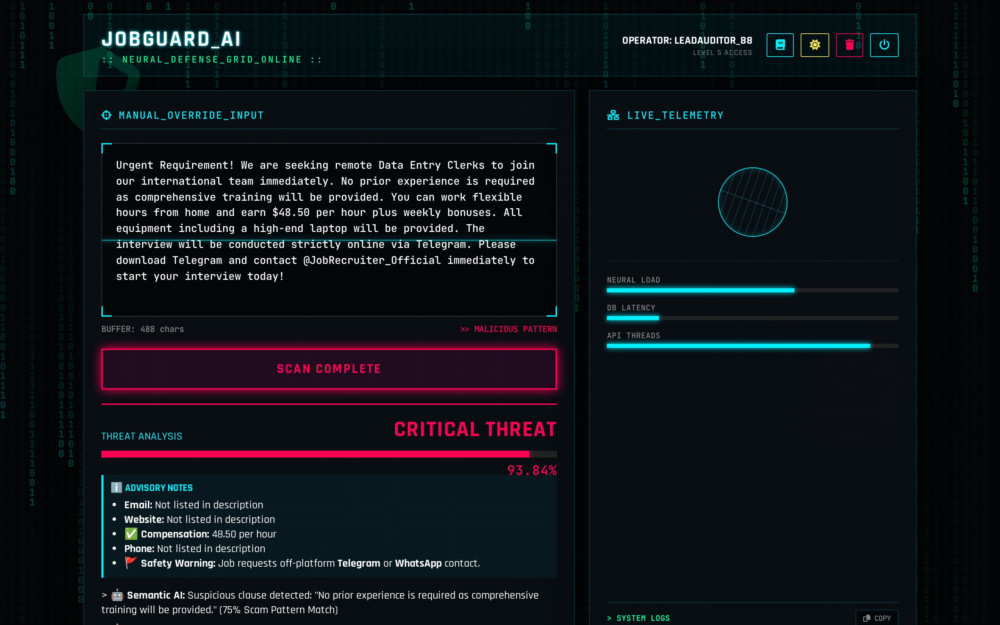 | 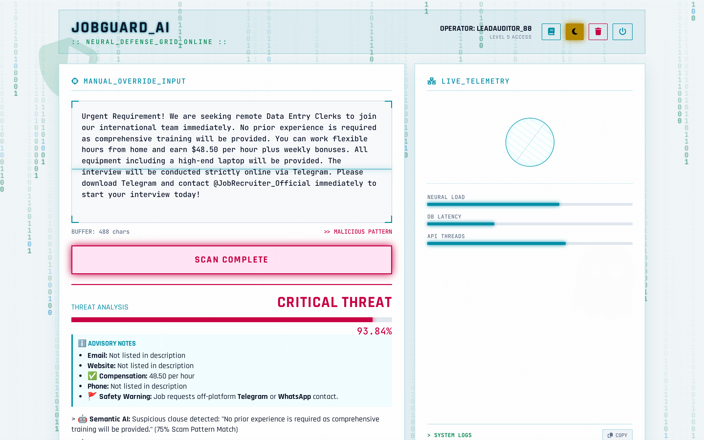 |

### 📟 Tablet Operator Console (iPad Pro 820 × 1180)
| Tablet Defense Console (Dark Theme) | Tablet Defense Console (Light Theme) |
|:---:|:---:|
| 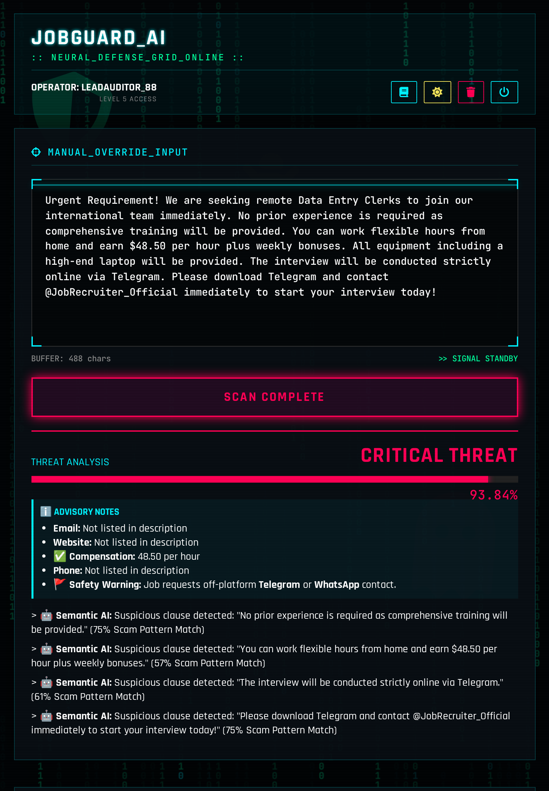 | 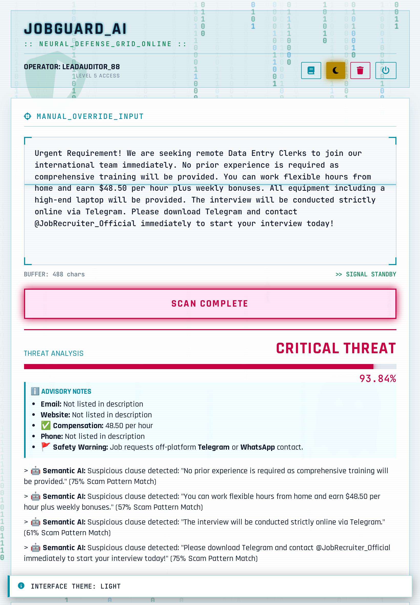 |

### 📱 Mobile Defense View (iPhone 15 Pro 393 × 852) & Auth Gateway
| Mobile Scan Result (Dark) | Mobile Scan Result (Light) | Identification Terminal | Mobile Auth Gateway |
|:---:|:---:|:---:|:---:|
| 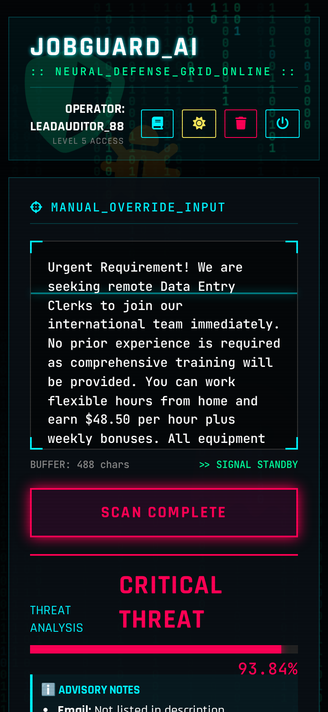 | 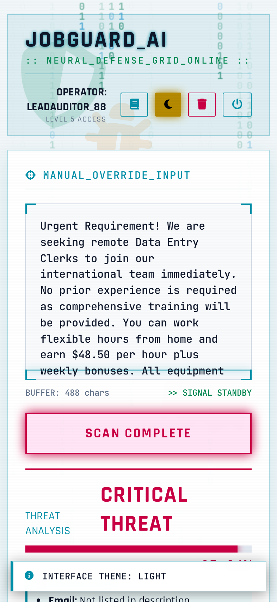 | 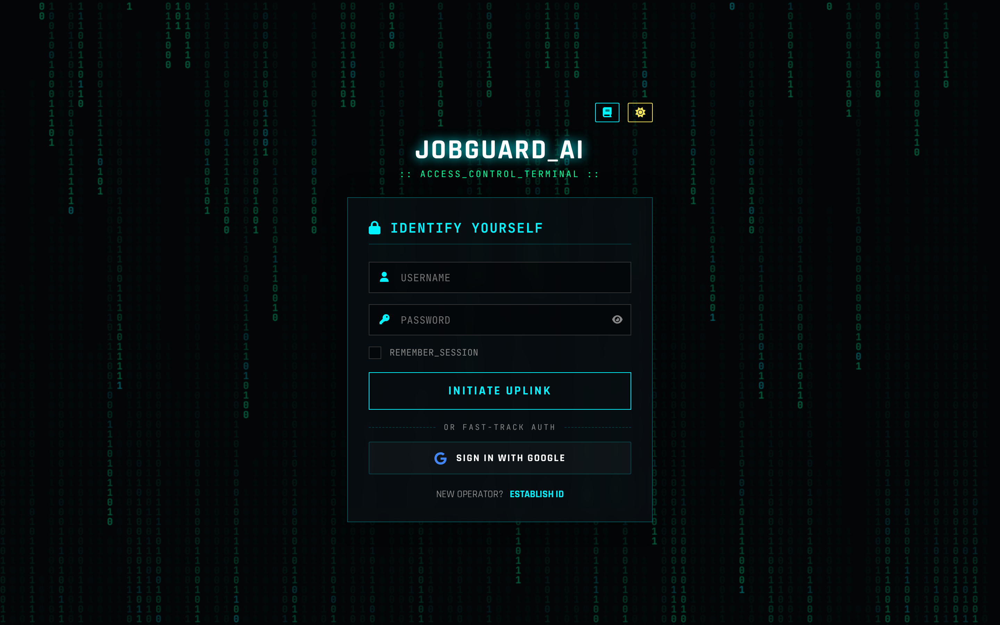 | 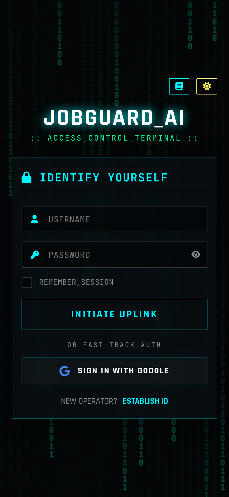 |

---

<a id='kaggle-specifications'></a>
## 🧪 Kaggle AI Training Environment & Model Specifications

The neural backbones and unsupervised feature compressors in JobGuard were trained and benchmarked on **Kaggle AI GPU Clusters**. Below are the exact hardware and library specifications extracted directly from training logs and model container metadata:

### Hardware & Acceleration
| Specification | Details |
|:--------------|:--------|
| **Compute Engine** | Kaggle GPU Environment |
| **Accelerators** | **2x NVIDIA Tesla T4 GPUs** (16 GB GDDR6 VRAM each, 32 GB total) |
| **CUDA Capability** | 7.5 (Turing Architecture) |
| **Training Precision** | Automatic Mixed Precision (AMP / FP16) |
| **Parallel Strategy** | PyTorch `torch.nn.DataParallel` across both GPUs |

### Kaggle Training Python & Library Stack
All models (`models/best_bert_fusion.pth`, `models/autoencoder.keras`, `models/iso_forest.pkl`, `models/meta_ensemble.pkl`) were exported under the following environment:

| Software / Library | Version | Role in Model Training & Serialization |
|:-------------------|:--------|:---------------------------------------|
| **Python** | **3.13** (`/usr/local/lib/python3.13/dist-packages/`) | Container runtime on Kaggle AI |
| **Keras** | **3.10.0** (Saved `2026-02-17@06:18:03`) | Autoencoder architecture (`batch_shape: [None, 768]`) |
| **PyTorch** | **2.8.0** | BERTFusion model training, dynamic quantization, GPU tensors |
| **TensorFlow** | **2.19.0** (`tensorflow-cpu` / `tensorflow`) | Graph runtime and Keras serialization backend |
| **Hugging Face Transformers** | **4.57.1** | `distilbert-base-uncased` fine-tuning and tokenization |
| **Sentence-Transformers** | **5.2.2** | `all-MiniLM-L12-v2` dense semantic anchor embeddings |
| **Scikit-Learn** | **1.6.1** | Meta-ensemble (`MLPClassifier`, `GradientBoostingClassifier`, `LogisticRegression`, `IsolationForest`) |
| **Joblib** | **1.3.2** | Scaler and scikit-learn model artifact serialization |
| **LIME** | **0.2.0.1** | Model-agnostic local explainability perturbation |
| **NumPy** | **2.0.2 / 2.1.3** | Tensor transformations and numerical feature vectors |
| **Pandas** | **2.2.2** | Dataset curation, balancing, and cleaning pipeline |

> [!IMPORTANT]
> **Keras 3 Compatibility Note:** `models/autoencoder.keras` uses the native modern Keras 3 container format. The application uses `keras.models.load_model` rather than legacy `tf.keras.models.load_model` to properly support `batch_shape` attributes without deserialization faults.

---

<a id='architecture'></a>
## 🔬 Deep Dive: The Neuro-Symbolic Architecture

JobGuard employs a **Multi-Stage Cognitive Pipeline** combining deep contextual neural representations with hard symbolic domain rules:

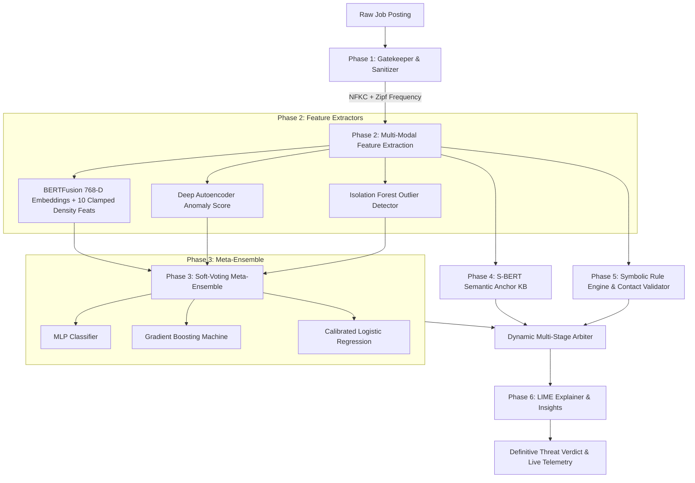

### Phase 1: Sanitization & Defensive Gatekeeping
- **NFKC Unicode Normalization:** Defeats homoglyph and zero-width character attacks designed to bypass keyword tokenizers.
- **Zipf Frequency Check (`wordfreq` + `pyenchant`):** Detects random keyboard mashes and syntactically malformed gibberish before neural activation.
- **Code Injection Block:** Identifies and halts raw source code pastes (C++, Java, Python, SQL) using structural syntax regex.

### Phase 2: Feature Extraction (The Sensors)
1. **Linguistic Representation (BERTFusion):**
   - Fine-tuned `distilbert-base-uncased` backbone with frozen lower layers and trained classification head.
   - Combined with 10 locked numerical indicators: clamped window density [300, 1200 chars], capitalization ratio, symbol density, urgency cues, administrative role flags, and contact vectors.
2. **Structural Anomalies (Autoencoder + IsoForest):**
   - **Deep Autoencoder:** Measures Mean Squared Reconstruction Error against genuine corporate postings.
   - **Isolation Forest:** Tree-based anomaly detection evaluating metadata distributions.

### Phase 3: Calibrated Meta-Ensemble
Predictions are aggregated through a Soft-Voting Meta-Ensemble:
$$P_{\text{ensemble}} = \frac{1}{3} \left(P_{\text{MLP}} + P_{\text{GBM}} + P_{\text{LogReg}}\right)$$

### Phase 4: S-BERT Semantic Anchor Matching
- Evaluates cosine similarity against 50+ pre-indexed fraudulent tactics using `all-MiniLM-L12-v2`.
- Employs negative contextual constraints to differentiate between benign mentions (*"conducted in-person"*) and red flags (*"no interview required"*).

### Phase 5: Symbolic Deterministic Overrides
- **Crypto & Wallet Trap:** Blocks payment solicitation via BTC, ETH, USDT, Tron, or Telegram wallets.
- **Off-Platform Communication Alert:** Flags illicit redirections to Telegram handles, WhatsApp vanity numbers, or Signal channels.
- **Pay-to-Work Guard:** Detects demands for training fees, equipment deposits, or background check purchases.

---

<a id='eda-insights'></a>
## 📊 Exploratory Data Analysis (EDA) & Feature Insights

Comprehensive exploratory data analysis, feature distributions, and forensic calibration metrics extracted from the 28,351 unique recruitment postings dataset:

### 1. Dataset Completeness & Target Distribution
| Missing Values Matrix | 50/50 Balanced Target Distribution |
|:---:|:---:|
| 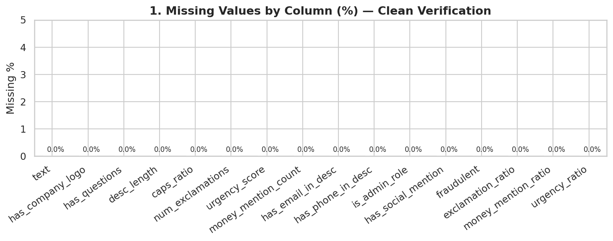 | 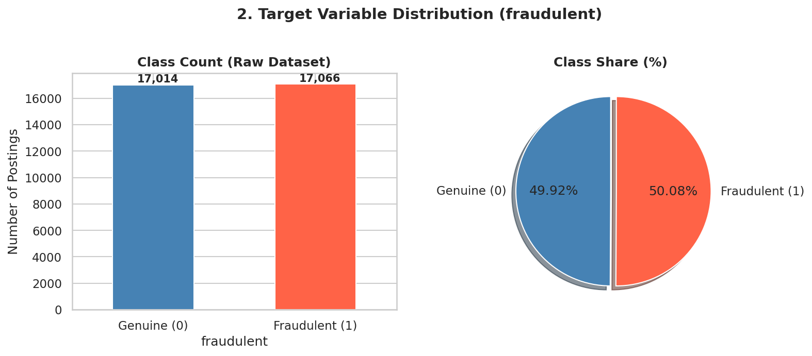 |

### 2. Feature Distributions & Target Discrepancies
| Numerical Feature Distributions | Boxplots by Target (Genuine vs. Scam) |
|:---:|:---:|
| 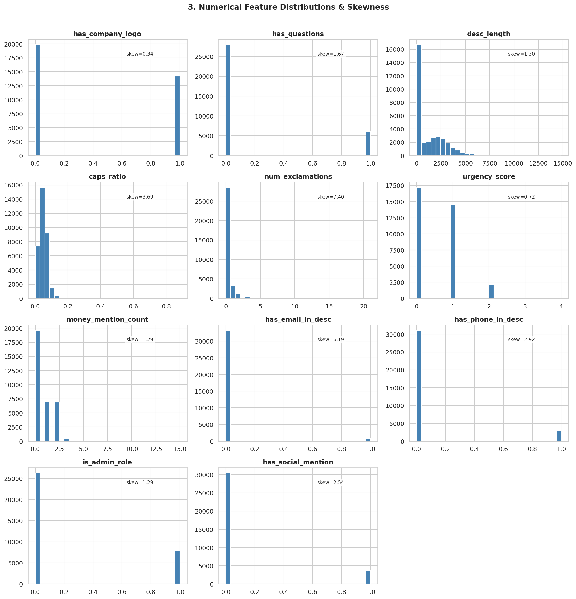 | 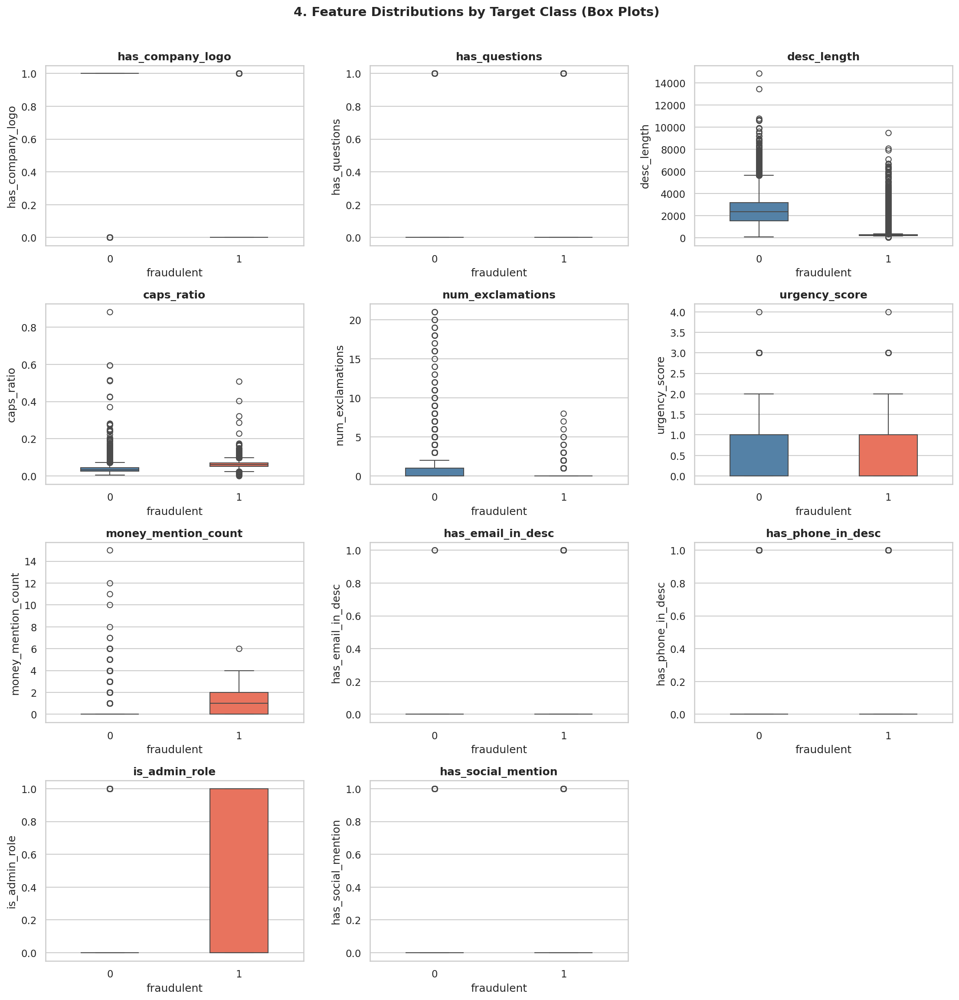 |

### 3. Binary Signals & Specific Fraud Probabilities
| Binary Indicator Distributions | Fraud Rates per Binary Indicator |
|:---:|:---:|
| 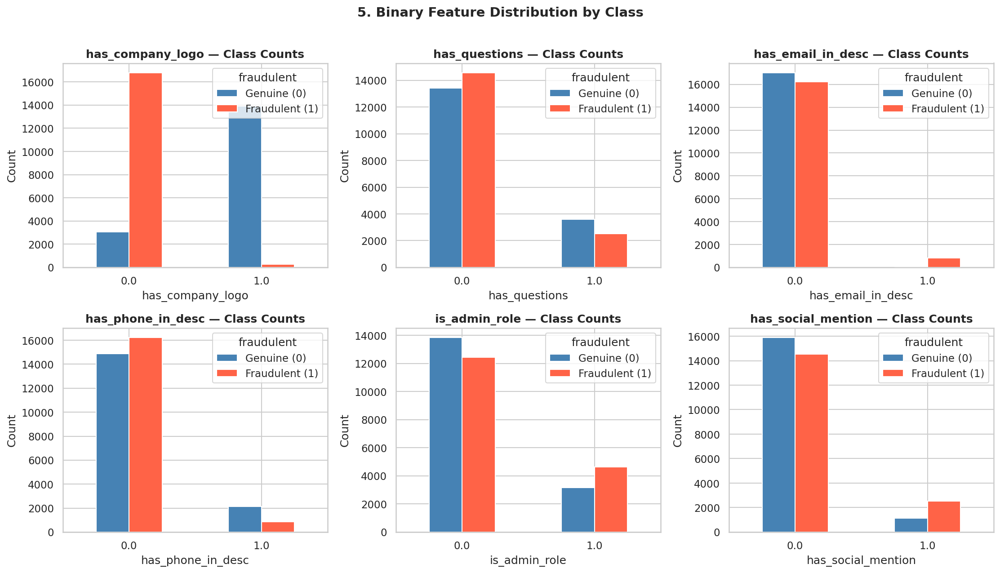 | 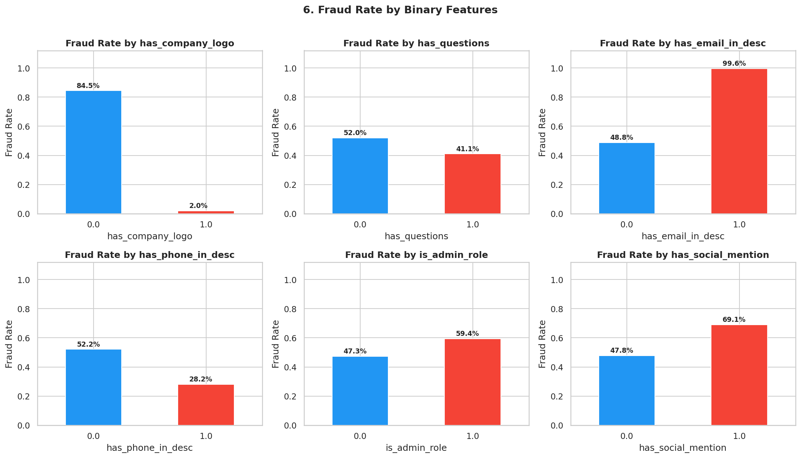 |

### 4. Correlation Analysis & Feature Ranking
| Feature Correlation Heatmap | Feature Correlations with Fraud Target |
|:---:|:---:|
| 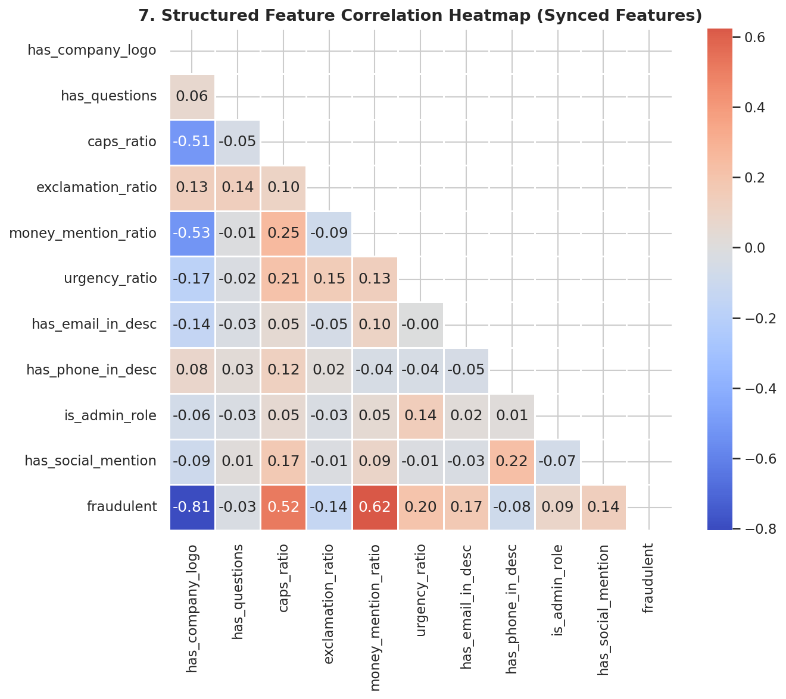 | 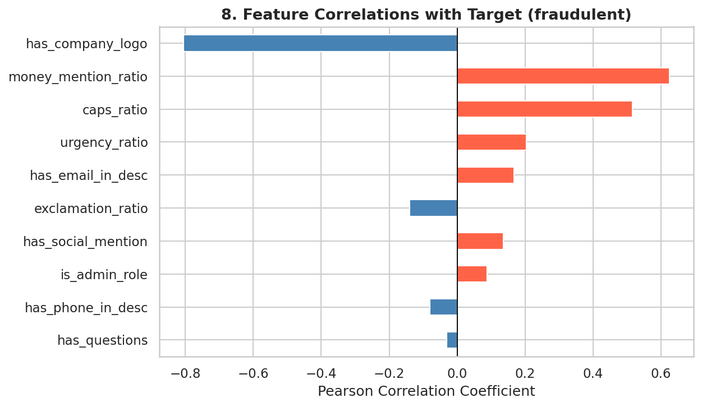 |

### 5. Linguistic Profiling & High-Risk Lexicons
| Description Length Analysis | Wordcloud Comparison (Genuine vs. Fraudulent) |
|:---:|:---:|
| 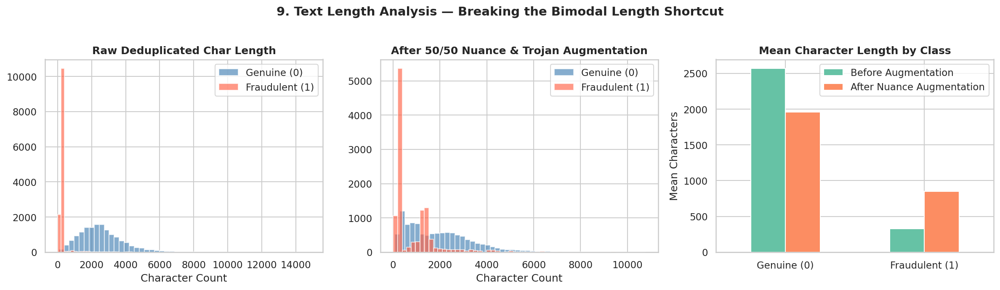 | 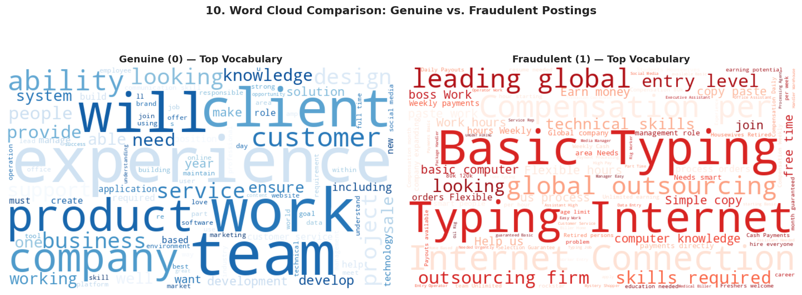 |

### 6. Exploited Job Titles & Neural Convergence
| Top Targeted Job Titles | BERTFusion Training & Validation History |
|:---:|:---:|
| 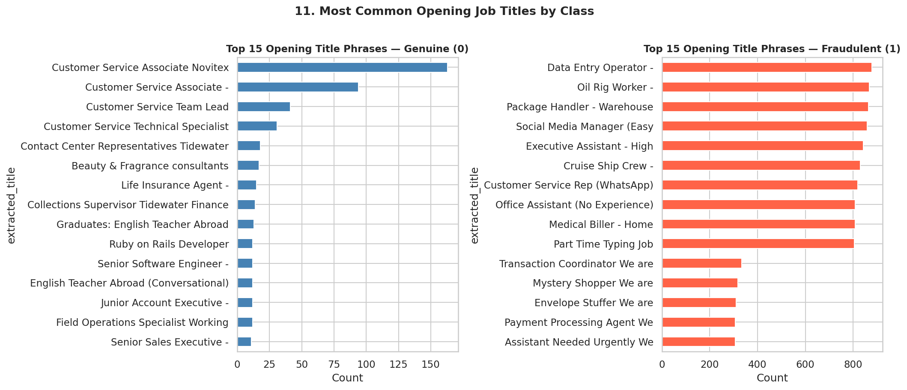 | 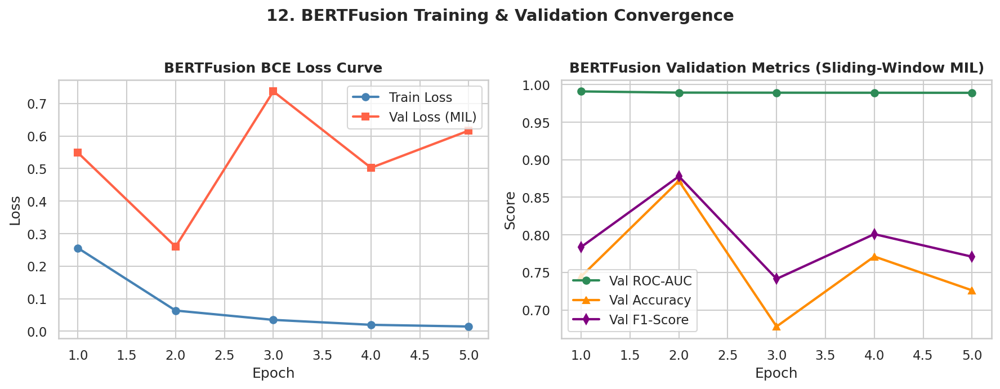 |

### 7. Forensic Anomaly Thresholds & Metric Calibration
| Autoencoder Reconstruction Error Separation | ROC & Precision-Recall Curves |
|:---:|:---:|
| 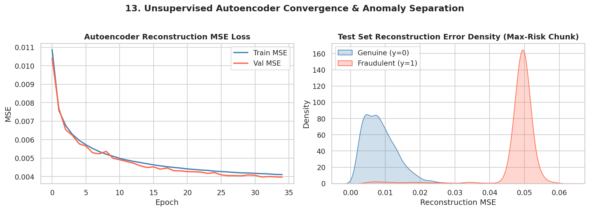 | 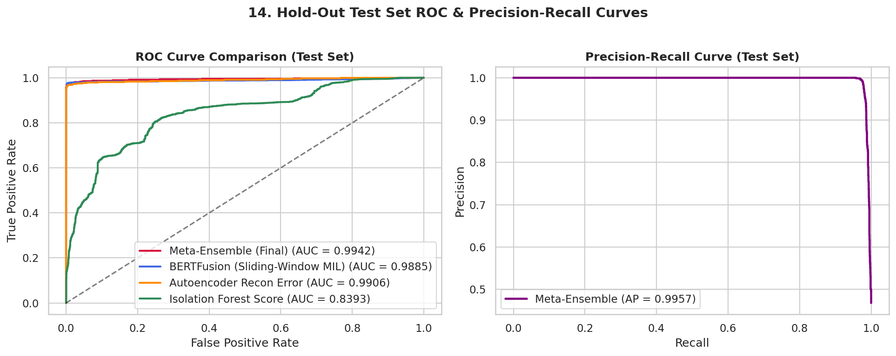 |

| Multi-Subgroup Confusion Matrix | Meta-Ensemble Feature Importance & Calibration |
|:---:|:---:|
| 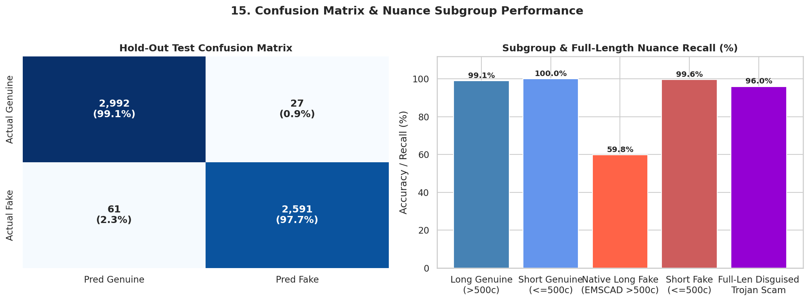 | 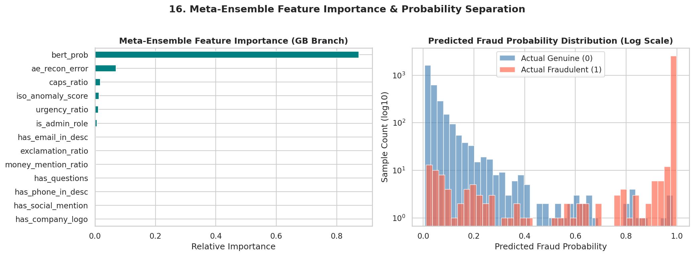 |

---

<a id='features'></a>
## ✨ Key Features & Capabilities

- 🔒 **Google OAuth 2.0 / OpenID Connect:** One-click biometric/Google SSO authentication with automatic operator account provisioning.
- 📱 **Mobile & Power-Saving Resilience:** Decoupled background task workers (`/api/scan`) with local storage state persistence. Mobile background tabs, sleep states, or reloads automatically recover the active scan without lost work or redundant GPU inference.
- 🎨 **Adaptive Theme Engine:** High-contrast Cyberpunk Terminal (default) and Clean Light Theme toggle with real-time CSS variable bindings.
- 📊 **OpenAPI / Swagger Interactive Documentation:** Explore and test all endpoints live at `/docs`.
- 🔍 **Explainable AI (XAI):** LIME highlights specific deceptive phrases directly in the job description to explain the decision.
- 📋 **Zero-Disruption In-App Alerts:** Custom cyberpunk toast notifications and interactive modals replace all legacy native `alert()`/`confirm()` dialogs.
- 🛡️ **Hardened Input Sanitization:** Protection against SQL injection, XSS vectors, buffer overflows, and negative text lengths.

---

<a id='oauth-setup'></a>
## 🔐 Google OAuth 2.0 Integration & Setup

JobGuard integrates Google OAuth 2.0 using `authlib` with OpenID Connect discovery.

### 1. Create Google Cloud Credentials
1. Navigate to the [Google Cloud Console](https://console.cloud.google.com/apis/credentials).
2. Create an **OAuth 2.0 Client ID** (Application type: *Web application*).
3. Set **Authorized redirect URIs**:
   - Local development: `http://localhost:7860/api/auth/google/callback` or `http://127.0.0.1:7860/api/auth/google/callback`
   - Production / Hugging Face: `https://<your-domain>/api/auth/google/callback`

### 2. Configure Environment Variables
Set the following environment variables before starting the server:

```bash
export GOOGLE_CLIENT_ID="your-google-client-id.apps.googleusercontent.com"
export GOOGLE_CLIENT_SECRET="your-google-client-secret"
export SECRET_KEY="your-secure-session-secret"
```

> [!NOTE]
> If Google OAuth credentials are not configured, JobGuard gracefully displays a toast notification warning the operator while keeping standard username/password authentication fully functional.

---

<a id='frameworks'></a>
## 📚 Frameworks & Library Specifications

Below is the verified production runtime stack (managed with `uv`):

| Package | Local Version | Role in JobGuard Engine |
|:--------|:--------------|:------------------------|
| `python` | `>=3.12, <3.14` (Supports 3.12 & 3.13) | Runtime language |
| `flask` | `3.1.2` | Production WSGI Web Framework |
| `flasgger` | `0.9.7.1` | OpenAPI / Swagger 2.0 auto-generator |
| `authlib` | `1.9.1` | OAuth 2.0 & OpenID Connect client |
| `torch` | `2.8.0` | PyTorch runtime & dynamic quantization |
| `transformers` | `4.57.1` | Hugging Face DistilBERT tokenizer & model |
| `sentence-transformers` | `5.2.2` | Semantic search embeddings |
| `tensorflow-cpu` | `2.19.0` | TensorFlow runtime for Keras models |
| `keras` | `3.10.0` | Keras 3 neural network deserialization |
| `scikit-learn` | `1.6.1` | Voting Ensemble & Isolation Forest inference |
| `lime` | `0.2.0.1` | Explainable AI (XAI) perturbations |
| `pyenchant` | `3.2.2` | Spell-checking dictionary validator |
| `wordfreq` | `3.1.1` | Zipf lexical frequency analyzer |
| `pytest` | `9.1.1` | Automated test suite framework |
| `playwright` | `1.64.0` | Headless browser end-to-end UI testing |

---

<a id='project-structure'></a>
## 📁 Project Structure

```bash
fake-job-detection-python/
├── app.py                            # Production Neuro-Symbolic Fraud Engine & API
├── Dockerfile                        # Multi-stage production container setup
├── packages.txt                      # System-level dependencies (libenchant-2-dev)
├── pyproject.toml                    # Declarative dependencies & project metadata
├── uv.lock                           # Pinned cross-platform dependency graph
├── users.db                          # SQLite user authentication database
│
├── .idea/
│   └── runConfigurations/            # PyCharm IDE One-Click Launch Configurations
│       ├── JobGuard_Server.xml
│       ├── PyTest_Endpoints_and_Security.xml
│       ├── PyTest_Playwright_UI_Tests.xml
│       └── Benchmark_Model_Inference.xml
│
├── docs/                             # Documentation & Visual Assets
│   ├── eda/                          # 16 High-Res EDA Graphs & Forensic Reports
│   │   ├── 01_missing_values.png
│   │   ├── 02_target_distribution.png
│   │   ├── 03_numerical_distributions.png
│   │   ├── 04_boxplots_by_target.png
│   │   ├── 05_binary_features_distribution.png
│   │   ├── 06_binary_feature_fraud_rates.png
│   │   ├── 07_correlation_heatmap.png
│   │   ├── 08_feature_correlations_with_target.png
│   │   ├── 09_desc_length_analysis.png
│   │   ├── 10_wordcloud_comparison.png
│   │   ├── 11_top_job_titles.png
│   │   ├── 12_bert_training_history.png
│   │   ├── 13_autoencoder_reconstruction_distribution.png
│   │   ├── 14_roc_and_pr_curves.png
│   │   ├── 15_confusion_matrix_and_subgroups.png
│   │   ├── 16_meta_feature_importance_and_calibration.png
│   │   ├── descriptive_statistics.csv
│   │   └── outlier_report.csv
│   └── images/                       # Cross-Device UI Showcase Assets
│       ├── dashboard_desktop_dark.png
│       ├── dashboard_desktop_light.png
│       ├── dashboard_tablet_dark.png
│       ├── dashboard_tablet_light.png
│       ├── dashboard_mobile_dark.png
│       ├── dashboard_mobile_light.png
│       ├── auth_terminal_dark.png
│       └── auth_terminal_mobile.png
│
├── models/                           # SOTA Serialized Model Artifacts (Kaggle Trained)
│   ├── best_bert_fusion.pth          # PyTorch DistilBERT + Heuristic Fusion Model
│   ├── autoencoder.keras             # Keras 3 Anomaly Compression Autoencoder
│   ├── iso_forest.pkl                # Scikit-Learn Isolation Forest
│   ├── meta_ensemble.pkl             # Soft-Voting Classifier (MLP + GBM + LR)
│   ├── bert_scaler.pkl               # Linguistic Feature Normalizer
│   └── tabular_scaler.pkl            # Structural Feature Normalizer
│
├── static/                           # Client-Side Assets
│   ├── css/
│   │   ├── style.css                 # Dashboard Cyberpunk & Light Theme Styling
│   │   └── login.css                 # Auth Gateway, Password Meter & OAuth Styles
│   └── js/
│       ├── script.js                 # Async Scan Worker, Theme Switcher & Modals
│       └── login.js                  # Auth Handlers, Password Check & Matrix Canvas
│
├── templates/
│   ├── index.html                    # Main Operator Defense Grid Dashboard
│   └── login.html                    # Identification Terminal & OAuth Gateway
│
└── tests/                            # Automated Verification Test Suites
    ├── test_endpoints_security.py    # 26 Endpoints, RBAC, Security & OAuth Tests
    ├── test_ui_playwright.py         # 14 Full-Stack Playwright E2E UI Tests
    ├── test_model_inference.py       # 24 Real vs. Fake Scam Benchmark Evaluations
    ├── test_job_descriptions.json    # Extensive Corpus of Attack Vectors & Legit JDs
    └── PLAYWRIGHT_TESTING.md         # Playwright Execution Guide & Architecture
```

---

<a id='installation'></a>
## ⚙️ Installation & Deployment

### Option A: Using `uv` (Recommended)
`uv` is an ultra-fast Python package and project manager:

```bash
# 1. Install system prerequisites (Ubuntu/Debian)
sudo apt-get update && sudo apt-get install -y libenchant-2-dev

# 2. Clone repository
git clone https://github.com/yoge-2004/fake-job-detection-python.git
cd fake-job-detection-python

# 3. Synchronize virtual environment
uv sync

# 4. Set OAuth environment variables (optional for local testing)
export GOOGLE_CLIENT_ID="your_client_id"
export GOOGLE_CLIENT_SECRET="your_client_secret"

# 5. Launch the application
uv run python app.py
```
Open [http://localhost:7860](http://localhost:7860) in your web browser.

### Option B: Docker Container
```bash
# Build the Docker image
docker build -t jobguard:latest .

# Run container with OAuth configuration
docker run -d -p 7860:7860 \
  -e GOOGLE_CLIENT_ID="your_id" \
  -e GOOGLE_CLIENT_SECRET="your_secret" \
  jobguard:latest
```

---

<a id='swagger-docs'></a>
## 📖 OpenAPI / Swagger Documentation

JobGuard provides complete Swagger 2.0 / OpenAPI documentation with live testing capabilities:

- **Swagger UI:** [http://localhost:7860/docs](http://localhost:7860/docs)
- **OpenAPI Specification JSON:** [http://localhost:7860/apispec_1.json](http://localhost:7860/apispec_1.json)

### Key Documented Endpoints
- `POST /predict`: Synchronous fraud inference endpoint (backwards compatible).
- `POST /api/scan`: Non-blocking background job dispatcher for intensive ML inference.
- `GET /api/scan_status/<job_id>`: Status and result polling endpoint for active scans.
- `GET /api/auth/google/login`: Initiates Google OAuth 2.0 authorization.
- `GET /api/auth/google/callback`: OAuth callback handler and session authorizer.
- `POST /api/signup` & `POST /api/login`: Standard operator registration and login.
- `GET /api/health`: Comprehensive system telemetry, memory metrics, and model statuses.

---

<a id='testing-suites'></a>
## 🧪 Automated Test Suites (PyTest & Playwright)

JobGuard includes three enterprise-grade test suites ensuring security, UI reliability, and AI accuracy:

### 1. Endpoints, Security & OAuth Tests (PyTest)
Validates all routes, unauthenticated redirects, password strength rules, SQL injection attacks, XSS sanitization, async scanning, and Google OAuth flows:
```bash
uv run pytest tests/test_endpoints_security.py -v
```
*Result: **26/26 PASSED**.*

### 2. End-to-End Browser UI Tests (Playwright)
Executes real browser interactions covering login, signup constraints, dark/light theme switching, asynchronous scan polling, copy buttons, deletion confirmation modals, and mobile viewport persistence:
```bash
uv run pytest tests/test_ui_playwright.py -v -s
```
*Result: **14/14 PASSED**.* (See [tests/PLAYWRIGHT_TESTING.md](tests/PLAYWRIGHT_TESTING.md) for detailed documentation).

### 3. Model Benchmark Evaluation
Runs JobGuard against 24 verified real and fraudulent job postings:
```bash
uv run python tests/test_model_inference.py
```
*Result: **100% Scam Recall, 75% Overall Accuracy, 3.70s Average Latency**.*

---

<a id='pycharm-setup'></a>
## 💻 PyCharm Run Configurations

Four ready-to-run PyCharm Run Configurations are included under `.idea/runConfigurations/`:

1. **`JobGuard Server`**: Runs `app.py` on `http://0.0.0.0:7860`.
2. **`PyTest Endpoints & Security`**: Runs all 26 endpoint, RBAC, and OAuth tests.
3. **`PyTest Playwright UI Tests`**: Runs end-to-end browser automation tests.
4. **`Benchmark Model Inference`**: Runs the 24-job inference evaluation benchmark.

These appear automatically in PyCharm's top run dropdown when opening this repository.

---

<a id='author'></a>
## 👤 Author & Acknowledgments

**Yogeshwaran**
- **Project:** JobGuard AI (Production Neuro-Symbolic Deception Defense)
- **Institution:** Panimalar Engineering College
- **Specialization:** Machine Learning Security, Adversarial NLP & Neuro-Symbolic Systems
- **Hugging Face Space:** [JobGuard AI on Hugging Face](https://yoge-2004-fake-job-detector.hf.space)

---

<a id='license'></a>
## 📜 License

Distributed under the **MIT License**. See [LICENSE](LICENSE) for details.
